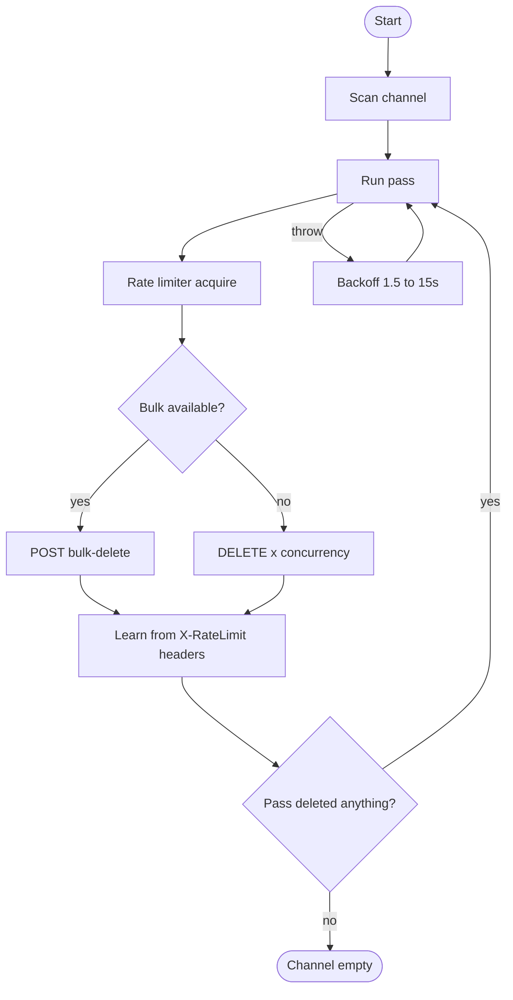
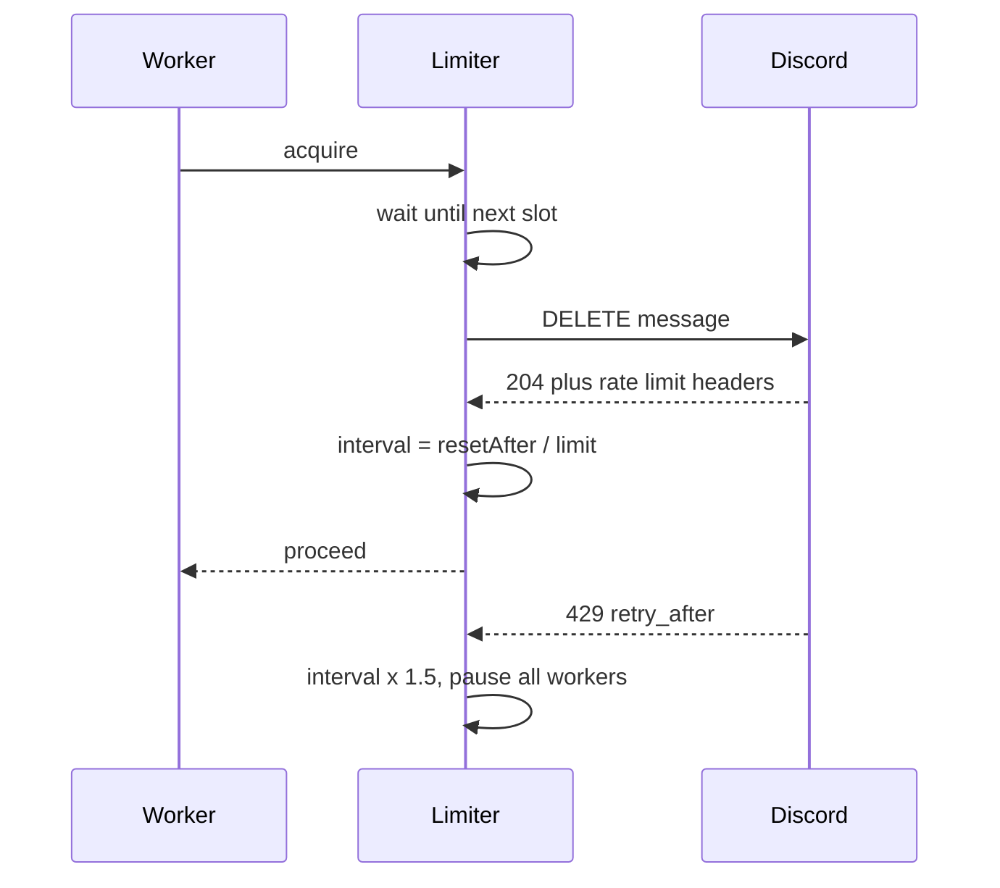

<div align="center">

```
██████╗ ███╗   ███╗██╗    ██╗██╗██████╗ ███████╗
██╔══██╗████╗ ████║██║    ██║██║██╔══██╗██╔════╝
██║  ██║██╔████╔██║██║ █╗ ██║██║██████╔╝█████╗
██║  ██║██║╚██╔╝██║██║███╗██║██║██╔═══╝ ██╔══╝
██████╔╝██║ ╚═╝ ██║╚███╔███╔╝██║██║     ███████╗
╚═════╝ ╚═╝     ╚═╝ ╚══╝╚══╝ ╚═╝╚═╝     ╚══════╝
```

**Bulk-delete any DM. Paced by Discord's own rate limits, filtered how you want, backed up before a single message goes.**

[](https://github.com/Vendicated/Vencord)
[](#local-installation)
[](#changelog)
[](#license)
[](#roadmap)

<sub>Deleting · Pacing · Filters · Backups · Queue · Stats · Crash reports</sub>

</div>

---

> [!TIP]
> Run a **Dry Run** first. It scans and reports without deleting, so you know exactly what is about to
> go before anything is irreversible.

---

## Contents

<details open>
<summary><b>Expand</b></summary>

**Getting started**
- [Features](#features)
- [Compatibility](#compatibility)
- [Local Installation](#local-installation)
- [Quick start](#quick-start)

**Using it**
- [Commands](#commands)
- [Context menu](#context-menu)
- [Status card](#status-card)
- [Pausing and cancelling](#pausing-and-cancelling)

**Configuration**
- [Settings](#settings)
- [Filters](#filters)

**Internals**
- [Architecture](#architecture)
- [Pacing engine](#pacing-engine)
- [Supervisor](#supervisor)
- [Failure handling](#failure-handling)
- [Crash reports](#crash-reports)
- [Data and persistence](#data-and-persistence)
- [Module map](#module-map)

**Reference**
- [Performance notes](#performance-notes)
- [Troubleshooting](#troubleshooting)
- [FAQ](#faq)
- [Roadmap](#roadmap)
- [Changelog](#changelog)
- [Limitations](#limitations)
- [License](#license)

</details>

---

## Features

<table>
<tr><td valign="top" width="50%">

### Deleting
- Every message in a DM, at any age
- Yours, theirs, or a mix
- Group DMs supported
- Individual REST deletes, so the two week bulk window never applies
- Automatic bulk endpoint use where Discord allows it, 100 per request

### Control
- Live progress card with bar, rate and ETA
- Pause, resume and cancel from four places
- Dry run mode
- JSON backup to clipboard or file
- Multi-channel wipe queue
- Lifetime stats with run history

</td><td valign="top" width="50%">

### Pacing
- Paces off `X-RateLimit-Limit`, `X-RateLimit-Remaining`, `X-RateLimit-Reset-After`
- Honours `retry_after` on every 429
- Global rate limiter, so concurrency cannot overshoot
- Adjustable concurrency for latency hiding

### Resilience
- A failed request can never end a run
- Self-restarting passes
- Resume offer if the client dies mid-run
- Automatic crash reports with full context

</td></tr>
</table>

---

## Compatibility

| | |
|---|---|
| **Client** | Vencord (desktop and web builds) |
| **Scope** | DMs and group DMs only |
| **Requires** | Nothing beyond Vencord |
| **Persists** | Stats, queue and resume marker via `DataStore` |
| **Network** | Discord API only, no third party services |

---

## Local Installation

1. Clone Vencord and install dependencies.

   ```sh
   git clone https://github.com/Vendicated/Vencord
   cd Vencord
   pnpm install
   ```

2. Create the plugin folder. `src/userplugins` does not exist by default.

   ```sh
   mkdir -p src/userplugins/DMWipe
   ```

3. Drop `index.tsx` inside it. The layout must be exactly:

   ```
   src/userplugins/DMWipe/index.tsx
   ```

4. Build and inject.

   ```sh
   pnpm build
   pnpm inject
   ```

5. Restart Discord and enable **DMWipe** under **Settings → Vencord → Plugins**.

> [!IMPORTANT]
> The build scans `src/plugins/*` and `src/userplugins/*` exactly one level deep. A `userplugins`
> folder nested inside `src/plugins` produces `Could not resolve "./plugins/userplugins"`, and a
> doubled folder like `DMWipe/DMWipe/index.tsx` is never scanned at all.

| Rule | Why |
|---|---|
| Exactly one level: `src/userplugins/DMWipe/index.tsx` | Each plugin folder is imported directly |
| No `userplugins` folder inside `src/plugins` | Breaks module resolution |
| Flatten unzipped repos | Nested folders are invisible to the scanner |
| Folder name matches the plugin `name` | Vencord warns on mismatch |

---

## Quick start

| Step | Action |
|---|---|
| 1 | Right-click the DM → **Dry Run (preview)** |
| 2 | Set `backup` to `Download .json` in plugin settings if you want a copy |
| 3 | Right-click → **Delete All Messages** |
| 4 | Watch the live card. Pause or cancel from the card, the notification, or `/wipe` |
| 5 | Review the summary card, or **Send Crash Report** if it ended badly |

> [!WARNING]
> Deleting is permanent. There is no undo. A dry run plus a backup takes about a minute.

---

## Commands

| Command | Arguments | Description |
|---|---|---|
| `/wipe` | `limit` `delay` `dry` | Delete every message in the current DM. Run again while active to stop it |
| `/wipequeue` | none | Run every DM in the queue, in order |
| `/wipestats` | none | Open the lifetime stats panel |

`limit` stops after N messages, `delay` overrides the minimum gap for that run only, `dry` scans
without deleting.

---

## Context menu

Right-click any DM in the sidebar.

| Item | Description |
|---|---|
| **Delete All Messages** | Confirms, then wipes. Shows `(running)` while active |
| **Dry Run (preview)** | Scans and reports without deleting |
| **Pause / Resume Wipe** | Holds all workers. Disabled when idle |
| **Cancel Wipe** | Stops after the current request. Disabled when idle |
| **Add / Remove from Wipe Queue** | Toggles this DM in the queue |
| **Run Wipe Queue (n)** | Runs the queue in order. Disabled when empty or busy |
| **Send Crash Report** | Files a report from current state |
| **DMWipe Stats** | Opens the stats panel |

---

## Status card

One client-local message, updated live. Deletes run newest first, so it naturally stays at the
bottom where you can reach it.

```
▰▰▰▰▰▰▰▰▰▰▰▰▰▱▱▱▱▱▱▱▱▱  61.4%
4 879 / 7 948 deleted  (12 kept)
3.8/s · 21m 04s elapsed · ETA 13m 12s
bulk · 240ms · pass 2
```

| Field | Meaning |
|---|---|
| Bar and percentage | Progress against the scan total |
| `deleted / total` | Count so far, plus how many messages the filters are keeping |
| `rate` `elapsed` `ETA` | Live throughput and projection |
| `mode` `ms` `pass` | Bulk or individual, current request spacing, pass number |

On completion it becomes a summary card:

```
DMWipe: all messages gone
channel    some person
deleted         7 936
failed              0
kept               12
duration      34m 51s
average         3.8/s
peak            6.1/s
```

> [!NOTE]
> The status card is client-local. It is never sent to Discord, so the wipe never deletes it, and it
> disappears on reload.

---

## Pausing and cancelling

Four independent routes, all landing in the same handler.

| Route | Notes |
|---|---|
| **Pause** / **Cancel** button on the status card | Fastest, always in view |
| **Pause** / **Cancel** button on the notification | Works if you scrolled away |
| Context menu | Works from anywhere in the client |
| `/wipe` again while running | Cancels |

All long waits use an interruptible sleep that wakes every 200 ms, so a cancel lands almost
immediately rather than after a backoff timer.

---

## Settings

### Pacing

| Setting | Type | Default | Description |
|---|---|---|---|
| `delay` | slider | `25` | Minimum gap between requests in ms. A floor, not a fixed speed |
| `adaptive` | toggle | on | Pace off Discord's rate limit headers |
| `concurrency` | number | `4` | Requests in flight at once. Only hides round-trip latency |

### Scanning and output

| Setting | Type | Default | Description |
|---|---|---|---|
| `countFirst` | toggle | on | Scan before deleting so the bar and ETA are real |
| `backup` | select | Off | `Clipboard`, `Download .json`, or `Both` before deleting |
| `confirm` | toggle | on | Confirmation modal before deleting |
| `notifyOnFinish` | toggle | on | Desktop notification when a run ends |

### Filters

All off by default. Any timestamp based filter forces a scan.

| Setting | Type | Default | Keeps |
|---|---|---|---|
| `keepPinned` | toggle | off | Pinned messages |
| `keepLast` | number | `0` | The newest N messages |
| `keepDays` | number | `0` | Anything newer than N days |
| `keepLinks` | toggle | off | Messages containing a link |
| `keepAttachments` | toggle | off | Messages with attachments |
| `keepReactions` | toggle | off | Messages that have reactions |
| `keepBots` | toggle | off | Messages sent by bots |
| `keepRegex` | text | empty | Messages matching the regex, case insensitive |

### Safety

| Setting | Type | Default | Description |
|---|---|---|---|
| `stuckPasses` | number | `5` | Empty passes before giving up |

---

## Filters

Filters apply identically while scanning and while deleting, so the count, the bar and the summary
always agree with what actually happened.

| Behaviour | Detail |
|---|---|
| `keepLast` resolves to a timestamp cutoff | Stable across restarts. A running counter would delete the kept messages on pass two |
| Invalid `keepRegex` | Logged and skipped, never breaks the run |
| Filtered messages | Reported as `kept` in the summary |

---

## Architecture



---

## Pacing engine



Every response carries Discord's own bucket numbers. The limiter computes the sustainable spacing as
`resetAfter / limit`, then tightens toward `resetAfter / remaining` when the bucket falls below 30
percent. It converges on the real ceiling from the first response instead of hunting for it.

A single global scheduler issues one request every `interval` ms no matter how many workers exist,
so concurrency only pipelines and can never cause extra 429s. A 429 multiplies the interval by 1.5
and pauses every worker until `retry_after` elapses. If headers are ever missing, a slow
multiplicative ease-down takes over as a fallback.

---

## Supervisor

One sweep of the channel is a pass. If a pass throws, it logs, backs off 1.5 to 15 seconds, and
starts a new pass from the newest message. Deletes are counted as they happen, so a thrown pass loses
no progress.

A run ends only when:

| Condition | Reason string |
|---|---|
| A pass finds nothing left | `all messages gone` |
| `limit` reached | `limit reached` |
| `stuckPasses` consecutive empty passes | `no progress` |
| Ten consecutive thrown passes | `gave up after N failed restarts` |
| You cancel | `stopped` |

---

## Failure handling

| Response | Action |
|---|---|
| `200` / `204` | Success |
| `404` | Already gone, counted as success |
| `429` | Wait `retry_after`, raise the interval, pause all workers, retry |
| `5xx` or thrown request | Progressive backoff, retry |
| `401` / `403` | No permission, counted as failed, run continues |

Paging uses a `before` snowflake cursor taken from the oldest message in each batch, so the cursor
stays valid after those messages are deleted. Bulk deletes cover only messages under two weeks old
and are probed once, falling back permanently after two rejections.

---

## Crash reports

Abnormal endings (`fatal error`, `gave up`, `no progress`) capture a report and file it
automatically. The finished card then shows **Send Crash Report** to resend it. The context menu
entry is always available and files a report from current state.

<details>
<summary><b>What a report contains</b></summary>

- Reason, error message, 10 line stack trace
- Channel, progress, rate, peak rate, mode, live limiter interval
- Every relevant setting and filter
- Lifetime stats
- User agent and platform
- Last uncaught `error` or `unhandledrejection`
- Plugin version

</details>

Reports go over the client's own request stack first, with a direct fetch as fallback, so one
transport failing never loses a report. No message content is included, only metadata and the event
log.

---

## Data and persistence

<details>
<summary><b>Stored keys</b></summary>

| Key | Contents | Cleared |
|---|---|---|
| `DMWipe_stats` | Lifetime counters and last 25 runs | Reset button in the stats panel |
| `DMWipe_queue` | Queued channel IDs | As each channel completes |
| `DMWipe_pending` | Resume marker for an in-flight run | When a run finishes |

</details>

**Queue.** Toggle membership from the context menu, run with `/wipequeue`. Channels process in order
and dequeue as they complete. Cancelling mid-queue leaves the rest queued.

**Resume.** If the client dies mid-run, enabling the plugin offers **Resume** or **Dismiss**.

---

## Module map

<details>
<summary><b>Internals</b></summary>

| Area | Functions |
|---|---|
| Entry | `wipeChannel`, `confirmAndWipe` |
| Sweeping | `runPass`, `scanChannel` |
| Requests | `deleteOne`, `deleteMany`, `bulkDelete` |
| Pacing | `createLimiter` |
| Filtering | `buildFilters`, `shouldKeep` |
| UI | `statusComponents`, `renderStatus`, `setStatus` |
| Reports | `captureSnapshot`, `buildReport`, `buildPayload`, `sendCrashReport` |
| Extras | `runQueue`, `openStats`, `writeBackup`, `channelContextPatch` |

</details>

---

## Performance notes

Throughput is bound by Discord's per-channel delete bucket, not by this plugin. The `rate/s` readout
is a live measurement of your actual ceiling.

| Situation | Expectation |
|---|---|
| Bulk endpoint available | Minutes for thousands of messages |
| Bulk unavailable | Bucket bound, often 2 to 6 per second |
| High latency connection | Raise `concurrency` to 6 or 8 |

If a run feels slow, check the console for `bulk delete unavailable`. Present means bucket bound and
`concurrency` is the only knob left. Absent means the limiter is still learning, and the `ms` value
on the card will settle.

---

## Troubleshooting

| Symptom | Cause | Fix |
|---|---|---|
| `Could not resolve "./plugins/userplugins"` | `userplugins` nested inside `src/plugins` | Move to `src/userplugins/DMWipe/`, delete the stray folder |
| `No matching export in ... for import ...` | Stale API path in an older copy | Use the current `index.tsx` |
| `Cannot create property 'id' on string` | `sendBotMessage` given a string | Pass `{ content: "..." }` |
| `bulk delete unavailable` | Bulk endpoint rejected | Expected. Raise `concurrency` |
| Run restarts repeatedly | Pacing under your ceiling | Leave `adaptive` on, or raise `delay` |
| Ends with `no progress` | Undeletable messages remain | Check the console for status codes |
| `failed` column not zero | Usually `403` on others' messages in group DMs | Expected. Raise `stuckPasses` |
| Cancel does nothing | Build not rebuilt | Use the notification button or `/wipe` |
| Regex never matches | Invalid pattern | Check console, invalid patterns are logged and skipped |

---

## FAQ

<details>
<summary><b>Can I delete the other person's messages?</b></summary>

Yes. In 1:1 DMs both participants can delete each other's messages, and the same is normally true in
group DMs. Where you lack permission, those messages land in the `failed` column instead of stopping
the run.

</details>

<details>
<summary><b>Does it work on servers?</b></summary>

No, DMs only. Guild channels have their own bulk endpoint and permission model.

</details>

<details>
<summary><b>Will it delete the status card?</b></summary>

No. It is client-local, never sent to Discord, so it is not part of the channel history.

</details>

<details>
<summary><b>Can I get the messages back?</b></summary>

Only from the JSON backup, and only if you enabled it before deleting. There is no server side undo.

</details>

<details>
<summary><b>Why is it not instant?</b></summary>

Discord rate limits deletes per channel. The limiter sits exactly at that limit, so the wall clock is
Discord's, not the plugin's.

</details>

---

## Roadmap

- [x] Header driven pacing
- [x] Filters and dry run
- [x] Backup before delete
- [x] Stats and queue
- [x] Crash reports
- [ ] Delete only your own messages toggle
- [ ] Attachment download alongside the JSON backup
- [ ] Per channel setting overrides
- [ ] Scheduled automatic wipes
- [ ] Progress card rendered as a real embed

---

## Changelog

<details>
<summary><b>History</b></summary>

| Version | Changes |
|---|---|
| `1.2.0` | Crash reports, filters, dry run, backup, stats, queue, resume, header driven pacing |
| `1.1.0` | Live progress card, pause and resume, per request retry ladder |
| `1.0.0` | Initial release |

</details>

---

## Limitations

- DMs only, no guild channels
- No undo
- Bulk delete covers only messages under two weeks old
- Messages you cannot delete in group DMs are counted as failed
- Status card, notification and toasts are local UI, they leave nothing behind
- Crash reports carry metadata and logs only, never message content

---

## License

GPL-3.0-or-later, matching Vencord.

<div align="center">
<sub>Built for Vencord. Delete responsibly.</sub>
</div>
